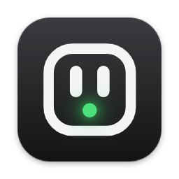
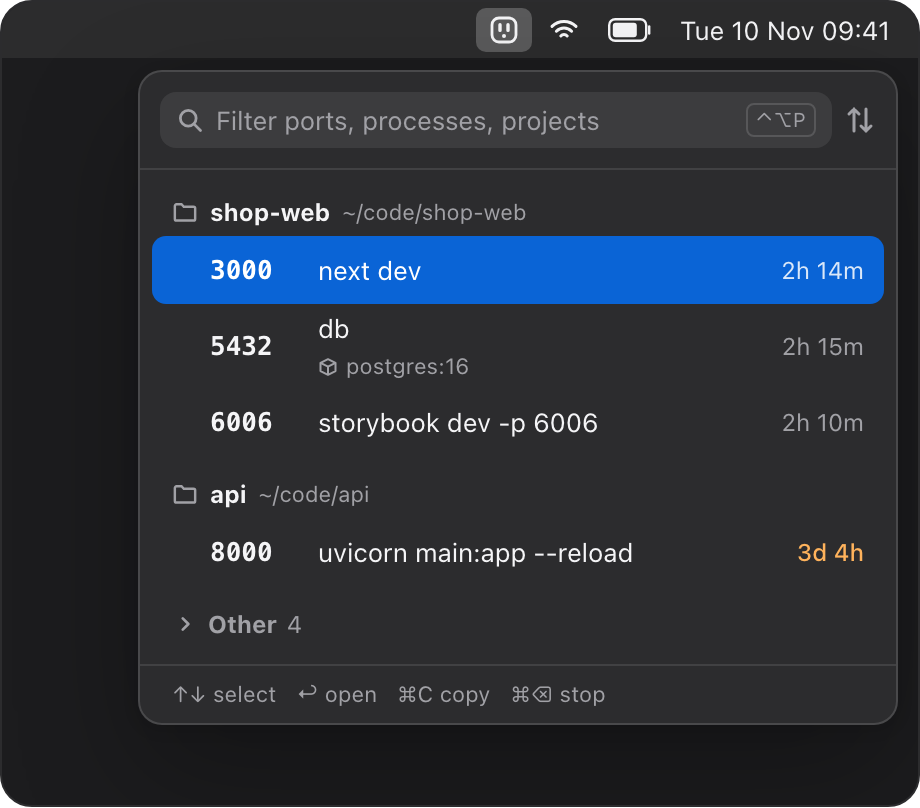

<p align="center">
  
</p>

<h1 align="center">peekport</h1>

<p align="center">See what's running on localhost.</p>

<p align="center">
  <a href="https://github.com/curiousigor/peekport/releases"></a>
  
  <a href="LICENSE"></a>
</p>

<p align="center">
  
</p>

<p align="center">A Mac menu bar app that lists every server listening on a local port, grouped by the project it was started from.<br>Open it, copy the URL or stop it, without a terminal.</p>

## Install

### Download

<a href="https://familiasi.gumroad.com/l/peekport"></a>

Free. macOS 15 Sequoia or newer, Apple Silicon and Intel. Signed and notarized by Apple.

### Build from source

You need Xcode 16 or newer. No dependencies.

```bash
git clone https://github.com/curiousigor/peekport.git
cd peekport
xcodebuild -scheme App -configuration Release -derivedDataPath build \
  CODE_SIGN_IDENTITY="-" DEVELOPMENT_TEAM="" CODE_SIGN_STYLE=Manual build
open build/Build/Products/Release/peekport.app
```

This makes a locally signed build for your own Mac. To build in Xcode instead, open `App.xcodeproj`, select the App target, and under Signing & Capabilities pick your own team or "Sign to Run Locally".

Run the tests with:

```bash
xcodebuild -scheme App -destination 'platform=macOS' test
```

`release/build.sh` makes the notarized release zip and needs the maintainer's Developer ID team.

## Features

- **Grouped by project.** Each port sits under the folder it was started from, found from the process's working directory.
- **Start commands.** `next dev`, `vite`, `uvicorn main:app` instead of three rows of "node".
- **Docker containers.** Published ports show the container and image, grouped with their compose project. Docker Desktop and OrbStack.
- **Stops what restarts it.** Stopping a server can also stop the `npm run dev`, `nodemon` or `turbo` behind it, or the whole compose project.
- **Down alerts.** Watch a port and get a notification when it stops listening.
- **Keyboard first.** ⌃⌥P from any app (or a shortcut of your own), arrows to select, Return to open, ⌘C to copy, ⌘⌫ to stop.
- **Project actions.** Reveal a project in Finder, or open it in your editor or terminal.

No account, no tracking, no network calls. About 16 MB of memory and no CPU while idle.

## How it works

- Listening ports come from `lsof -iTCP -sTCP:LISTEN -nP`, run off the main thread.
- The project folder is the nearest folder with a `.git`, `package.json` or similar above the process's working directory, read with `proc_pidinfo`. The start command comes from the process's arguments and is shown only.
- Ports published by Docker are matched to containers with the local `docker` CLI, only while Docker owns a port.
- Stopping sends SIGTERM, and SIGKILL only after a timeout and a confirmation. Only your own processes are listed.

peekport is not sandboxed: a sandboxed app cannot list other processes' sockets or signal them. That is also why it is distributed outside the Mac App Store.

## Contributing

Issues and pull requests are welcome. It's a side project, so reviews can take a while.

## License

[MIT](LICENSE)
